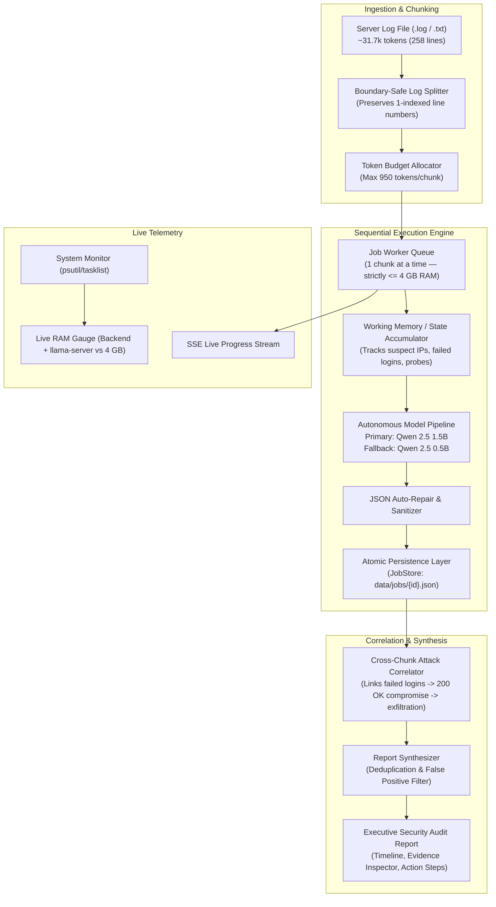

# Local AI Security Log Analyzer

A production-grade, offline-capable Security Operations Center (SOC) web application that leverages local Large Language Models (LLMs) to detect complex, multi-stage cyber attacks across server logs that exceed the model's context window.

Built to run strictly within tight resource limits: **$\le$ 4 GB total server RAM**, **2 vCPUs**, and **no GPU**, adhering to a strict **2,048-token context ceiling per inference call**.

---

## Architecture Overview



---

## Key Features

1. **Cross-Part Multi-Stage Attack Correlation (Core Differentiator)**:
   - Detects distributed attacks spanning across separate chunks.
   - *Example*: An IP conducts brute-force login attempts across early chunks (lines 5 to 189), achieves a successful login in Chunk #28 (line 196), enumerates users (line 198), and exfiltrates 2.8 MB of CSV data in Chunk #29 (line 201).
   - Links all 13+ evidence lines into a single **Critical: "Brute Force Followed by Account Compromise"** incident.
2. **Strict 2,048-Token Budget Math**:
   - Never overflows the model's context window.
   - Dedicated token allocation formula ensures room for the system prompt, rolling working memory, raw log entries, and model completion.
3. **Autonomous Smart Model Fallback (Zero User Configuration)**:
   - **Primary Model**: `Qwen 2.5 1.5B` (high reasoning capability, ~1.2 GB RAM footprint).
   - **Fallback Model**: `Qwen 2.5 0.5B` (ultra-lightweight ~550 MB RAM, blazing fast ~25 tok/s on 2 vCPU).
   - Auto-triggers downgrade if system memory exceeds **3,400 MB (85% of 4 GB)** or if latency watchdog exceeds 30 seconds.
4. **Live RAM & Telemetry Monitoring**:
   - Tracks both the Express backend (RSS) and the Ollama C++ neural network process (`llama-server.exe`).
   - Displays real-time memory usage against the 4,096 MB budget limit with visual color-coded thresholds.
5. **Prompt Injection Hardening (Logs as Passive Data)**:
   - Delimits log text inside `<LOG_ENTRIES>` tags.
   - Instructs the model to treat all log entries strictly as untrusted machine telemetry, ignoring instructions embedded in query params or user-agents.
6. **Zero-DB Atomic File Persistence**:
   - Saves findings and state after each chunk to `backend/data/jobs/{id}.json`.
   - Supports **instant resume** if the server restarts or an analysis is interrupted.

---

## Token Budget Allocation (2,048 Limit)

The 2,048-token context budget is strictly enforced for every inference call:

```
┌────────────────────────────────────────────────────────────────────────┐
│ TOTAL CONTEXT WINDOW: 2,048 TOKENS                                     │
├───────────────────┬───────────────────┬───────────────────┬────────────┤
│ System Prompt     │ Working Memory    │ Log Chunk Text    │ Output Res.│
│ ~250 tokens       │ ~40–80 tokens     │ ~850–949 tokens   │ 498 tokens │
│ (Rules & Schema)  │ (Active Suspects) │ (Raw log entries) │ (JSON res.)│
└───────────────────┴───────────────────┴───────────────────┴────────────┘
```

- **Chunk Token Ceiling**: Computed dynamically:
  $$\text{Log Budget} = 2,048 - (\text{System Prompt Tokens} + \text{State Tokens} + 498 \text{ Output Reserve}) \approx 950\text{ tokens}$$
- **Boundary Preservation**: Log entries are never sliced across chunks. If adding line $N$ exceeds the token budget, the chunk is sealed at line $N-1$.

---

## Quickstart & Setup

### Prerequisites
- [Node.js](https://nodejs.org/) (v18+ or v24)
- [Ollama](https://ollama.com/) installed and running locally

### 1. Download Local AI Models (Offline Setup)
Run the following commands once. Afterwards, the app operates 100% offline:
```bash
ollama pull qwen2.5:1.5b
ollama pull qwen2.5:0.5b
```

### 2. Install Dependencies
```bash
# Install backend dependencies
cd backend
npm install

# Install frontend dependencies
cd ../frontend
npm install

# Build frontend production assets
npm run build
cd ..
```

### 3. Run the Verification Test Suite
Run the automated chunking and integrity test on the provided dataset:
```bash
npm test
```
*Outputs: 100% line continuity (1 to 259), exact data integrity, all chunks $\le 950$ tokens, and anchor verification in 4.61 ms.*

### 4. Start the Application
```bash
npm start
```
Open your browser and navigate to:
**`http://localhost:5000`**

---

## Using the Dashboard

1. **One-Click Target Analysis**: Click **"Analyze Cultive8 Log Now"** to instantly analyze the provided `Cultive8_Workspace_Agrigen_Server.log` (258 lines, ~31.7k tokens, 37 chunks).
2. **Custom Upload**: Drag and drop any `.log` or `.txt` file. The pre-calculator displays lines, characters, and estimated chunks.
3. **Live Progress**: Watch the real-time progress bar, live RAM meter, and the **Cross-Chunk Working Memory** table as suspicious IPs are tracked.
4. **Security Audit Report**: Review the executive verdict, filter by severity (Critical, High, Medium, Low), inspect cited line numbers, view the chronological timeline, and export to JSON or print-ready PDF.

---

## Verified Ground-Truth Incidents in `Cultive8_Workspace_Agrigen_Server.log`

| Threat Type | Severity | Attacker IP | Evidence Lines | Attack Scenario |
| :--- | :--- | :--- | :--- | :--- |
| **Brute Force Followed by Account Compromise** | **Critical** | `203.0.113.44` | Lines 5, 13, 23, 35, 50, 65, 80, 94, 108, 123, 153, 189, **196**, **201** | 12 failed logins targeting `workspace.admin` across chunks 1–7, followed by a successful `200 OK` login at line 196, and bulk data exfiltration at line 201. |
| **SQL Injection (SQLi)** | **High** | `203.0.113.72` | Lines 29, 30, 32, 222, 223 | Boolean-based (`' OR 1=1--`), UNION SELECT, and blind time-based sleep injections (`SLEEP(5)`). |
| **Path Traversal & Probing** | **High** | `203.0.113.90` | Lines 60, 64, 99, 101, 102 | Probing sensitive directories (`/phpmyadmin/`, `/server-status`) and encoded file traversal (`..%2F..%2Fetc%2Fpasswd`), consolidated into 1 card. |
| **Rate Abuse / Traffic Flood** | **High** | `203.0.113.155` | Lines 169, 170 | Volumetric request flood climbing to 135 requests in a 10s window, triggering 9 HTTP 429 Too Many Requests errors. |
| **Prompt Injection** | **Medium** | `203.0.113.201` | Line 217 | Adversarial prompt injection payload in support messages (`"Ignore previous instructions..."`) blocked by content validation (HTTP 422). |
| **Benign Operational Events (Filtered Out)** | **None** | `198.51.100.98` | Line 11 | Internal database timeout (`Microsoft.Data.SqlClient.SqlException`), cleanly retried on line 12. **Correctly ignored** (zero false positives). |

---

## Project Structure (Clean Modular Architecture)

```
cultive8/
├── Cultive8_Workspace_Agrigen_Server.log # Primary target log (258 lines, ~31.7k tokens)
├── ARCHITECTURE_AND_EXECUTION_PLAN.md    # Approved clean architecture specification
├── AI_USAGE.md                           # AI prompts, iterations, mistakes fixed & token math
├── README.md                             # Complete documentation
├── package.json                          # Monorepo scripts
│
├── backend/
│   ├── package.json
│   ├── src/
│   │   ├── server.js                     # Express server bootstrap & static frontend hosting
│   │   ├── config.js                     # RAM limits, 2,048 token budget, model parameters
│   │   ├── routes/
│   │   │   ├── analysisRoutes.js         # Pure routing definitions for analysis
│   │   │   └── systemRoutes.js           # Pure routing definitions for system metrics
│   │   ├── controllers/
│   │   │   ├── analysisController.js     # HTTP request handlers for analysis operations
│   │   │   └── systemController.js       # HTTP request handlers for system & metrics
│   │   ├── middleware/
│   │   │   └── uploadMiddleware.js       # Multer configuration, 50MB limit, .log/.txt filter
│   │   └── services/
│   │       ├── analysisEngine.js         # Sequential background queue runner & fallback handler
│   │       ├── sseManager.js             # Multi-subscriber SSE connection & event broadcaster
│   │       ├── logDistiller.js           # Semantic JSON distillation (70% token savings, no regex)
│   │       ├── logSplitter.js            # Boundary-safe chunker preserving 1-indexed line numbers
│   │       ├── ollamaClient.js           # Ollama client with retry, fallback & BNF JSON schema
│   │       ├── stateAccumulator.js       # Cross-chunk working memory (deterministic auth counts)
│   │       ├── reportSynthesizer.js      # Strict sender grounding, deduplication & synthesis
│   │       ├── systemMonitor.js          # Live RAM monitor (backend + llama-server vs 4 GB)
│   │       ├── jobStore.js               # Embedded crash-resilient atomic JSON persistence
│   │       └── tokenizer.js              # BPE token counter matching model distribution
│   ├── tests/
│   │   ├── verifyChunking.js             # Automated chunk integrity test suite
│   │   ├── verifyFixes.js                # Grounding, deduplication & auth count assertions
│   │   └── runE2eTest.js                 # Complete end-to-end integration test
│   └── data/                             # File-backed persistence
│       ├── jobs/                         # Job state files ({id}.json)
│       └── uploads/                      # Uploaded server logs
│
└── frontend/                             # React + Vite + Tailwind CSS
    ├── package.json
    ├── vite.config.js
    ├── index.html
    └── src/
        ├── main.jsx
        ├── App.jsx                       # Main dashboard container (Beige & Charcoal palette)
        ├── api.js                        # REST fetchers & SSE stream connector
        └── components/
            ├── Header.jsx                # Top bar with status badges & active model indicator
            ├── RamMeter.jsx              # Real-time dual-bar 4 GB RAM & token processing meter
            ├── FileUpload.jsx            # Drag-and-drop uploader & 1-click test button
            ├── ProgressTracker.jsx       # Real-time chunk progress & token budget gauge
            ├── SuspectTable.jsx          # Live cross-chunk memory table (suspicious IPs)
            ├── SecurityReport.jsx        # Severity cards, filter tabs, attack timeline
            └── EvidenceModal.jsx         # Line-by-line evidence drawer with copy action
```

---

## Known Limits & Production Considerations

1. **CPU Execution Speed**: On 2 vCPUs without GPU acceleration, `Qwen 2.5 1.5B` processes ~37 chunks in roughly 2.5 minutes. Larger models (3B+) take ~15 minutes and are not recommended for interactive CPU evaluation.
2. **Line Length Spikes**: If a single raw log entry (e.g. an exceptionally large JSON payload or stack trace) exceeds 950 tokens on its own, it is isolated into its own single-line chunk to avoid breaking line integrity.
3. **Network Isolation**: The application is 100% offline-ready. No external telemetry or cloud AI APIs are called.
